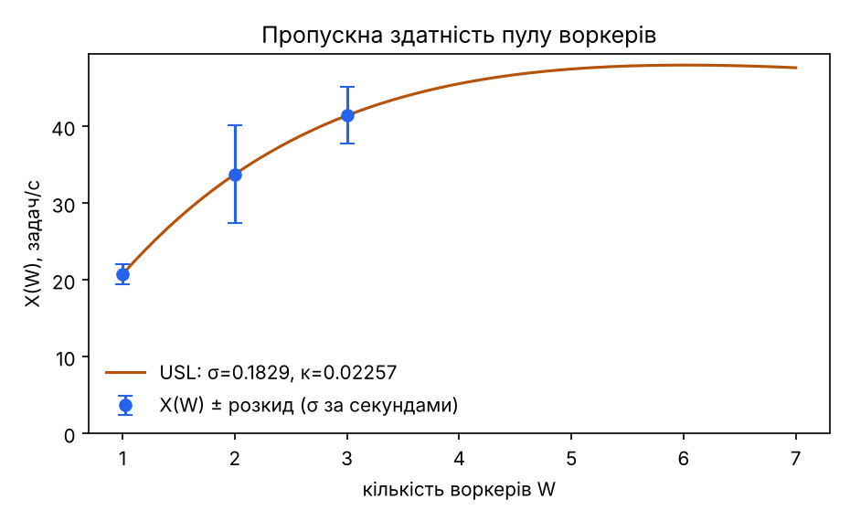
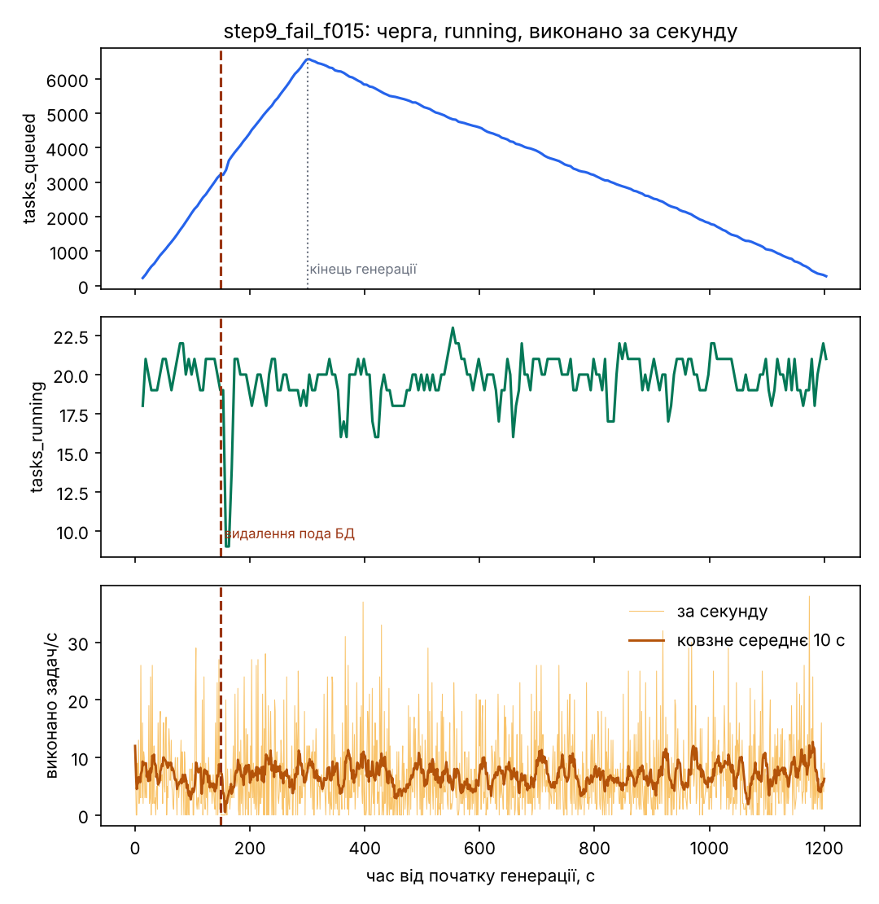
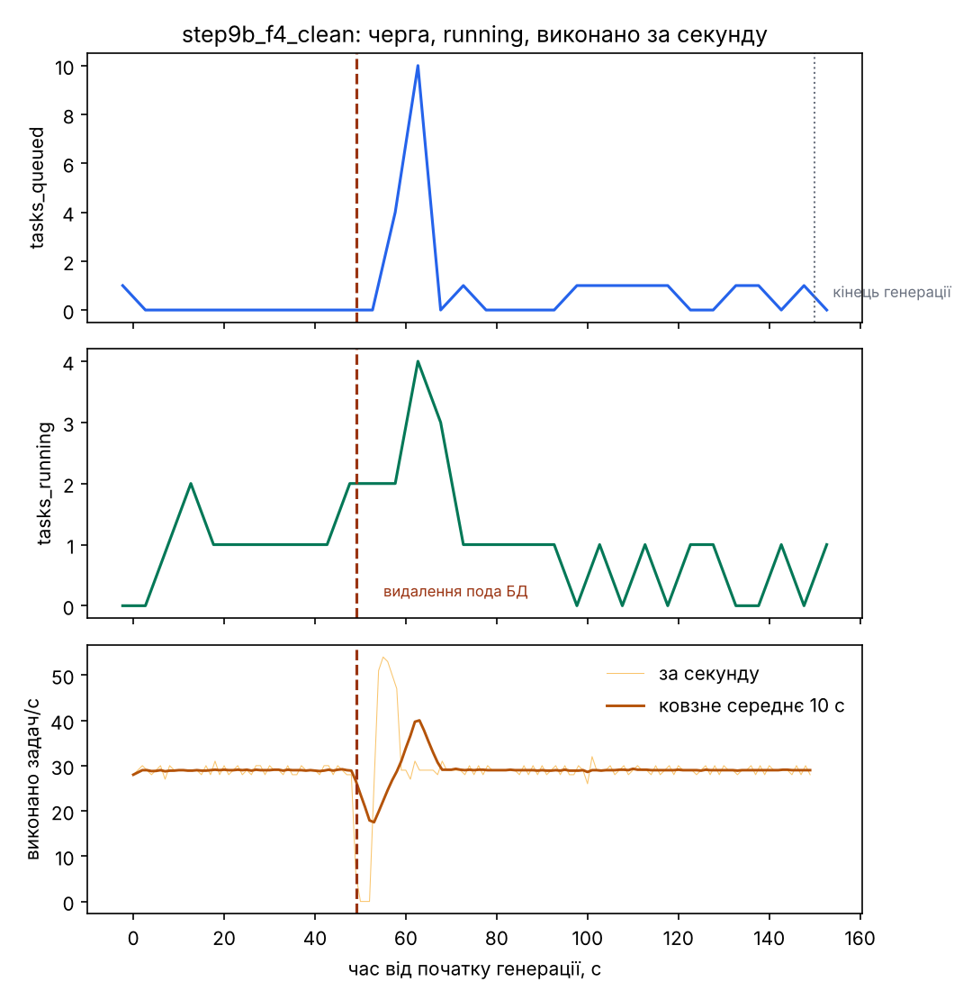

# Лабораторна робота 4. Синхронізація пула воркерів (варіант 3)

Розширення сервісу Лабораторної 3: черга задач у PostgreSQL, пул воркерів, захоплення задач із блокуванням рядків,
lease/heartbeat/fencing token, ідемпотентний запис результату, коректна зупинка, сценарій відмови Ф4 і додаткова вимога Д3.

Параметри варіанта 3: ресурс `/appointments`, R = 3, q_lo/q_hi = 0.01/0.99, T_poll = 50 мс, L = 15 с (heartbeat кожні 5 с),
сценарій відмови Ф4 (видалення пода БД), додаткова вимога Д3, розмір зрізу S = 256.

## Склад

| Шлях | Призначення |
|---|---|
| `db/init.sql` | таблиці `appointments` (Лаб. 1), `tasks`, `task_results`, індекс `(status, created_at)` |
| `app/tasks.py` | `POST /appointments/{id}/tasks` (202), `GET /tasks/{id}`, `GET /tasks`; gauge `tasks_queued`, `tasks_running` (зріз із БД кожні 5 с); повернення прострочених задач у чергу кожні 5 с |
| `worker/main.py`, `worker/processing.py` | воркер: захоплення (`naive` / `forupdate` / `skiplocked`), heartbeat, токен, ідемпотентний запис, SIGTERM, `FAIL_RATE`, Д3; обробка зрізу на чистому Python |
| `Dockerfile.worker`, `k8s/worker.yaml` | окремий образ і Deployment `worker` (без `replicas`; requests.cpu 250m, limits.cpu 500m, memory 512Mi, grace 30 с) |
| `k8s/monitoring/worker-servicemonitor.yaml` | збір метрик воркерів у Prometheus |
| `load_generator/task_generator.py` | розімкнений генератор створення задач для 100 записів |
| `tools/lab4.py` | оркестратор: послідовно виконує кроки 2–10 і збирає сирі дані в `results/` |
| `analysis/lab4_analysis.py` | обробка `results/`: таблиці (`results/analysis_lab4.md`) і графіки (`analysis/out/`) |

## Розгортання і запуск

Файл `.env` з рядком `POSTGRES_PASSWORD=...` у git не додається.

```
powershell -ExecutionPolicy Bypass -File .\scripts\deploy.ps1
python tools\lab4.py check
python tools\lab4.py step2 | step3 | step4 --n4 2000 | step5
python tools\lab4.py step6 --count1 1000 --count2 2000 --count3 3000
python tools\lab4.py step7 --xr 41.43
python tools\lab4.py step8 --xr 41.43
python tools\lab4.py step9 --xr 41.43
python tools\lab4.py step9b --xr 41.43
python tools\lab4.py step10 --count 2000
python analysis\lab4_analysis.py
```

`deploy.ps1` створює кластер `lab4` (kind, 1 control-plane + 2 worker), будує образи `appointments-web:lab4`
і `appointments-worker:lab4`, виконує міграцію і підіймає web, воркер (1 репліка) та Prometheus (збір кожні 5 с).
Сирі дані кожного прогону лежать у `results/` (`<мітка>_tasks.csv`, `_results.csv`, `_worker_logs.txt`, `_prom.json`,
`_meta.json`, `gen_<мітка>.json|csv`); таблиці з них рахує `analysis/lab4_analysis.py` у `results/analysis_lab4.md`.
Логи web у `results/` скорочено до рядків без access-журналу (залишено службові рядки і `[requeue]`).

## Реалізація

* **Задача** складається з трьох кроків: `GET /appointments/{record_id}` через web (HTTP), обробка зрізу 256×256, запис результату.
  Синтетичний зріз будується ЛКГ (x(0) = seed, x(i+1) = (1103515245·x(i) + 12345) mod 2³¹, p(i) = x(i+1) ≫ 19), далі
  гістограма на 4096 рівнів, p_lo і p_hi за квантилями 0.01 і 0.99, розтягування контрасту; результат: p_lo, p_hi,
  кількість вилучених пікселів, середнє і стандартне відхилення p'. Чистий Python, без NumPy.
  Квантиль рівня q: найменший рівень v, для якого накопичена кількість пікселів ≥ q·n (умова не задає визначення).
* **Захоплення** (змінна `CLAIM_MODE`): `naive` (SELECT найстарішої `queued` і окремий UPDATE без транзакції і блокувань),
  `forupdate` (одна команда `UPDATE … WHERE id = (SELECT … LIMIT 1 FOR UPDATE)`), `skiplocked` (те саме з `FOR UPDATE SKIP LOCKED`).
  Кожне захоплення збільшує `token` і `attempts`, задає `lease_until = now() + L`.
* **Lease, heartbeat, fencing token.** L = 15 с, heartbeat кожні 5 с (`UPDATE … WHERE id AND token`). Запис результату в одній
  транзакції: `UPDATE tasks SET status='done' … WHERE id AND token`; якщо оновлено 0 рядків, транзакція відкочується
  (результат відкинуто, подія `lost`); інакше `INSERT … ON CONFLICT (task_id) DO NOTHING`.
* **Повернення в чергу** прострочених задач виконує web кожні 5 с (`status='queued'`; при `attempts ≥ max_attempts` статус `failed`).
* **Коректна зупинка.** SIGTERM: воркер перестає брати нові задачі, завершує поточну і виходить із кодом 0; якщо задача
  не завершилась за 25 с (менше за `terminationGracePeriodSeconds` = 30), вона повертається в чергу (`UPDATE … WHERE id AND token`).
* **Д3.** Кандидат вибирається серед записів без running-задач (`NOT EXISTS`, `FOR UPDATE SKIP LOCKED`), потім у цій самій
  транзакції `pg_try_advisory_xact_lock(hashtext(record_id))` і повторна перевірка нового знімка. Лише `NOT EXISTS` не гарантує
  виключення: два воркери одночасно не бачать незафіксованих running-задач один одного.
* **Метрики воркера:** `worker_tasks_total{result}`, `worker_claims_total{result}`, `worker_task_duration_seconds{step}`,
  `worker_tasks_in_flight`; web: `tasks_queued`, `tasks_running` (зріз із БД кожні 5 с).

## Відхилення від умови і застереження

1. **Крок 5.** `kill -STOP 1` у контейнері не працює: PID 1 ігнорує SIGSTOP, надісланий зсередини свого простору процесів. У Deployment
   увімкнено `shareProcessNamespace: true`, воркер пише свій PID у `/tmp/worker.pid`, і зупинка виконується
   `kill -STOP $(cat /tmp/worker.pid)`; момент зупинки обирається, коли воркер уже взяв задачу (файл `/tmp/inflight`).
2. **Крок 9.** З типовою затримкою CrashLoopBackOff (до 300 с) воркер, що аварійно завершується за `FAIL_RATE`, майже не працює
   (див. нижче, прогін `step9_defaultbackoff`). Для основного прогону кластер створено заново з максимальною паузою перезапуску
   контейнера 1 с (`crashLoopBackOff.maxContainerRestartPeriod` у `KubeletConfiguration`, `k8s/kind-config.yaml`). Кроки 2–8
   виконано на кластері без цього патча (там воркери не аварійно завершуються, тому патч на них не впливає); кроки 9, 9b і 10 виконано на новому кластері.
3. **Крок 9b** (окремий прогін Ф4 без аварій воркерів) додано, щоб відокремити наслідки видалення БД від наслідків `FAIL_RATE`.
4. **Крок 6.** Кількість задач збільшено до 1000/2000/3000 для W = 1/2/3 (400 задач закінчувались швидше за 30 с), вікно вимірювання 30 с до
   моменту, коли останню задачу взято в роботу. Генератор працює з інтенсивністю 100 задач/с, тому в кінці вікна черга ще не порожня.
5. **Крок 4.** У першому прогоні з 300 задач навантаження тривало ~4 с, і Lock-очікування не потрапили у вибірку; прогін повторено з 2000
   задач і вибіркою раз на 0.2 с. Наведено лише повторний прогін. Кожна конфігурація виконана один раз; висновки про різницю
   між конфігураціями на одному прогоні наближені (повторюваності не оцінювали).
6. Усі виміри на одній машині (Docker Desktop, kind), де генератор, три воркери, web і БД ділять процесор хоста.
7. Квантилі часу claim оцінено за бакетами гістограми, тому похибка дорівнює ширині бакета.

## Результати

### Крок 2. t_io і t_cpu (1 воркер, 20 задач)

| величина | середнє, мс | медіана, мс | σ, мс | мін, мс | макс, мс |
|---|---|---|---|---|---|
| t_io = fetch + store | 9.18 | 8.30 | 1.90 | 6.86 | 13.97 |
| t_cpu = process | 29.24 | 27.50 | 7.46 | 22.98 | 49.32 |

1/(t_io + t_cpu) = 26.0 задач/с; 1/(t_io + t_cpu + T_poll/2) = 15.8 задач/с.

### Крок 3. Наївне захоплення (R = 3, 300 задач, 100 задач/с)

| T_poll | рядків у task_results | задач із >1 результатом | D = n_dup/n |
|---|---|---|---|
| 50 мс | 348 | 46 | 0.153 |
| 1 мс | 335 | 34 | 0.113 |

D, пораховане за таблицею результатів, за подіями claim і за подіями done у логах воркерів, збігається (кожна дублікатна задача
виконана двічі). Гонка: два воркери читають той самий `queued`-рядок між SELECT і UPDATE. При T_poll = 1 мс D менший, ніж при 50 мс;
одного прогону на конфігурацію недостатньо, щоб пояснити різницю впевнено (імовірна причина: при 50 мс воркери, які прокинулися
одночасно після порожньої черги, частіше читають один і той самий рядок).

### Крок 4. `FOR UPDATE SKIP LOCKED` і `FOR UPDATE` (R = 3, 2000 задач, 100 задач/с)

| режим | T_poll | D | claim p99 | порожніх claim | макс. Lock-очікувань |
|---|---|---|---|---|---|
| SKIP LOCKED | 50 мс | 0 | (10; 25] мс | 363 | 0 |
| SKIP LOCKED | 1 мс | 0 | (10; 25] мс | 9606 | 0 |
| FOR UPDATE | 50 мс | 0 | (100; 250] мс | 328 | 2 |
| FOR UPDATE | 1 мс | 0 | (10; 25] мс | 9571 | 1 |

Одна команда з блокуванням рядка прибирає дублікати (D = 0 в усіх чотирьох прогонах). Різниця між режимами видна в хвості часу claim
і в очікуваннях на блокуванні (FOR UPDATE без SKIP LOCKED змушує воркери чекати один одного, SKIP LOCKED пропускає зайняті рядки),
а в пропускній здатності вона не проявилась (≈ 29–31 задач/с за час розбору 2000 задач). Порожні claim у режимі FOR UPDATE також включають
випадки, коли після очікування блокування рядок уже не відповідає умові `status='queued'`.

### Крок 5. Втрата lease (2 воркери, 100 задач, `kill -STOP` на 30 с)

| величина | значення |
|---|---|
| задача в роботі в момент зупинки | 2 (воркер `…64vmq`) |
| рядок до зупинки (id, status, attempts, token, worker) | 2, running, 1, 1, `…64vmq` |
| рядок після спливання lease | 2, done, 2, 2, `…j9h9z` |
| воркер, що завершив задачу | `…j9h9z` |
| лог зупиненого воркера після `kill -CONT` | `heartbeat_zero_rows` (id 2, token 1) і `lost` (updated 0, результат відкинуто) |
| рядків у `task_results` для задачі 2 | 1 |

З 100 задач лише одна мала `attempts > 1`; задач із двома результатами немає.

### Крок 6. Пропускна здатність X(W) (30 с до спорожнення черги)

| W | задач | X(W), задач/с | розкид (σ за секундами) | claim p99 | транзакцій БД/с | CPU БД, ядер | CPU воркера, ядер/под | тротлінг CFS |
|---|---|---|---|---|---|---|---|---|
| 1 | 1000 | 20.73 | 1.31 | (25; 50] мс | 102 | 0.15 | 0.53 | 1.00 |
| 2 | 2000 | 33.77 | 6.40 | (50; 100] мс | 149 | 0.17 | 0.58 | 0.85 |
| 3 | 3000 | 41.43 | 3.69 | (50; 100] мс | 170 | 0.20 | 0.48 | 0.83 |

X(1) = 20.73 задач/с проти 1/(t_io + t_cpu + T_poll/2) = 15.77 (+31.5 %) і 1/(t_io + t_cpu) = 26.03 (−20.3 %): при непорожній
черзі воркер не чекає T_poll, а решту розбіжності, імовірно, пояснює тротлінг CFS (під працює на межі limits.cpu = 500m, частка 1.00) і відмінність
умов від кроку 2 (там задачі йшли поодинці); окремо це не перевіряли.

C(W) = X(W)/X(1): C(2) = 1.629, C(3) = 1.998. МНК за y = σu + κv (y = W/C − 1, u = W − 1, v = W(W − 1)):
Σu² = 5, Σv² = 40, Σuv = 14, Σuy = 1.2304, Σvy = 3.4633, det = 4; **σ = 0.183, κ = 0.0226, W\* = √((1 − σ)/κ) ≈ 6.0**.
Оцінки обох параметрів невід'ємні, поправок не потрібно. Оцінка спирається на дві точки (W = 2, 3) при двох параметрах, тому
похибки не має; графік: `analysis/out/lab4_usl.png`. Під БД майже не завантажений, тож обмеження не в ньому; за ємністю пулу
вузьким місцем є спільний процесор хоста і web (його ліміт 500m) — це гіпотеза, окремо її не перевіряли.



X(R) = X(3) = **41.43 задач/с**; для кроків 7–9: 0.7·X(R) = 29.0 і 1.3·X(R) = 53.9 задач/с.

### Крок 7. Закон Літтла (R = 3)

Усталений режим 0.7·X(R) = 29.0 задач/с, 180 с, останні 120 с (3480 задач у вікні):

| величина | значення |
|---|---|
| λ | 29.000 задач/с |
| W_q = середнє (started_at − created_at) | 0.0138 с |
| λ·W_q | 0.400 |
| L_q: середнє `tasks_queued` (gauge, зріз раз на 5 с) | 0.458 |
| розбіжність за gauge | 12.7 % |
| L_q: точне середнє з таблиці задач (за часом) | 0.400 (розбіжність 0 %) |

Точне L_q обчислено з тих самих `created_at`/`started_at`, що й W_q, тому збіг із законом Літтла тут майже тавтологічний; про
виконання закону свідчить порівняння з gauge. Розбіжність 12.7 % зумовлена шумом: черга ≈ 0.4 задачі, gauge береться раз на 5 с
(24 відліки у вікні), тож його середнє вимірює малу величину грубо. W_q ≈ 14 мс складається здебільшого із затримки опитування
(T_poll/2 = 25 мс, коли воркер простоює).

Перевантаження 1.3·X(R) = 53.9 задач/с, 120 с: довжина черги наприкінці генерації **1759**, W_q перших 100 задач 0.155 с,
останніх 100 задач **41.8 с**. Перевірка: черга росла на 1759/120 ≈ 14.7 задач/с, отже пул обробляв ≈ 39.2 задач/с (на 5 % менше за X(R));
останні задачі чекали 1759/41.4 ≈ 42.5 с, виміряно 41.8 с. Графік: `analysis/out/lab4_overload.png`.

### Крок 8. Коректна зупинка (`kubectl rollout restart`, 0.7·X(R), 120 с, перезапуск на 40-й секунді)

| показник | значення |
|---|---|
| код виходу контейнерів трьох старих подів | 0, 0, 0 (`Completed`) |
| подій `sigterm` / `exit(code=0)` у логах | 3 / 3 |
| задач, повернутих у чергу воркерами під час зупинки | 0 |
| задач у `failed` | 0 |
| задач із більше ніж одним результатом | 0 |
| задач з `attempts > 1` | 0 |
| задач усього, не `done` | 3480, 0 |

Задачі короткі (~40 мс), тому кожен воркер встигав завершити поточну задачу до закінчення grace period. Гілка із поверненням у чергу
(`UPDATE … WHERE id AND token`) у цьому прогоні не виконувалась.

### Крок 9. FAIL_RATE = 0.15, R = 3, 0.7·X(R) = 29.0 задач/с, 300 с, видалення пода БД на 149-й секунді

| показник | значення |
|---|---|
| перезапуски контейнерів (kubectl get pods) | 525, 521, 528 (разом 1574; за Prometheus 1560) |
| розподіл спроб серед 8513 завершених задач (1 / 2 / 3) | 0.845 / 0.132 / 0.023 (очікувано 0.850 / 0.1275 / 0.0225) |
| частка `failed` | 30/8513 = 0.0035 (очікувано f³ = 0.0034) |
| середня кількість спроб | 1.178 (очікувано 1 + f + f² = 1.172) |
| задач із більше ніж одним результатом | 0 |
| X за 300 с; до видалення БД | 6.92; 6.15 задач/с (X(R) без аварій 41.43) |
| наприкінці 300 с генерації | 6591 задач у черзі, потім черга розбиралась до ≈ 1200 с |

Пропускна здатність впала приблизно на 85 %: кожна аварія коштує перезапуску контейнера (пауза 1 с і запуск Python), а це
набагато більше за час самої задачі. `tasks_running` тримається близько 20 при трьох воркерах: задачі аварійно завершених
воркерів лишаються в `running` до спливання lease (1560 перезапусків за ≈ 1200 с ≈ 1.3 аварії/с, помножено на L = 15 с дає ≈ 20).
Розподіл кількості спроб і частка `failed` збігаються з теорією.



**Прогін із типовою затримкою CrashLoopBackOff** (`step9_defaultbackoff`, до зміни kubelet): по 7 перезапусків на под за 300 с, виконано
лише 104 задачі з 8696 (X ≈ 0.24 задач/с), чергу не спорожнено за 15 хв; серед 104 завершених розподіл спроб 0.82 / 0.15 / 0.03.
Тут воркери майже весь час простоювали в очікуванні перезапуску, і сценарій Ф4 нічого не вимірював (жодної running-задачі в момент
видалення), тому цей прогін залишено як окреме спостереження, а основним взято прогін нижче.

### Сценарій Ф4 (видалення пода БД)

| показник | крок 9 (з аваріями воркерів) | крок 9b (FAIL_RATE = 0) |
|---|---|---|
| недоступність БД за зондом `/healthz` (5 запитів/с) | 7.6 с | 3.0 с |
| новий под `db-0` Ready (kubectl) | 2.0 с | 2.0 с |
| задач повернуто в чергу (рядки `[requeue]` у логах web, 120 с після видалення) | 146 (змішано з аваріями воркерів) | **1** |
| задач у `running` у момент видалення, з них із `attempts > 1` | 21 з 22 | 0 з 1 |
| POST …/tasks не 2xx | 66 (64 тайм-аути) | **4** (2 × 500, 2 × розрив з'єднання) із 4350 |
| задач із більше ніж одним результатом | 0 | 0 |

Чисті значення сценарію дає прогін 9b: БД недоступна 3.0 с, 1 задачу повернуто в чергу, 4 із 4350 відповідей POST не 2xx, дублікатів результатів немає,
уся черга дообробилась (4346 задач `done`). Пропускна здатність після відновлення тимчасово перевищила λ (до 54 задач/с), поки розбиралась черга, що
накопичилась за 3 с простою. У комбінованому прогоні число 146 включає і задачі, які повернулись у чергу після аварій воркерів
(кожна аварія залишає задачу в `running` до спливання lease), тому його не слід приписувати лише видаленню БД; для такого прогону
недоступність 7.6 с довша, ніж у чистому, імовірно через навантаження від аварій, але окремо це не перевіряли.



### Крок 10. Д3: не більше однієї running-задачі на record_id (5 записів, R = 3, 2000 задач, 100 задач/с)

| прогін | X(R), задач/с | розкид | пар перекритих інтервалів running одного record_id | макс. одночасних running на record_id | моментів із двома running (вибірка 0.5 с) |
|---|---|---|---|---|---|
| без обмеження | 47.97 | 2.36 | **2** | 2 | 0 з 111 |
| з обмеженням Д3 | 45.93 | 2.70 | **0** | 1 | 0 з 114 |

Перекриття перевірено за інтервалами `[started_at, finished_at)` усіх задач одного record_id (метод точний). Вибірка кожні 0.5 с моментів
із двома running у БД нічого не виявила в обох прогонах: перекриття тривають частки секунди і в неї не потрапили, тому надійним є лише
порівняння за інтервалами. Обмеження коштувало ≈ 4 % пропускної здатності (відношення 0.958); різниця порівнянна з розкидом по секундах (≈ 2.4–2.7
задачі/с) і отримана одним прогоном на конфігурацію, тому висновок про її значущість обережний. Абсолютне X(R) тут вище, ніж у кроці 6 (47.97 проти 41.43),
бо прогін виконано на новому кластері і лише з 5 записами; причину різниці окремо не досліджували, тому порівнювати слід прогони між собою.

## Висновки

* Без блокувань захоплення задач дає дублікати (D ≈ 0.11–0.15); одна команда з `FOR UPDATE` (з `SKIP LOCKED` або без) прибирає їх повністю.
  Різниця між режимами проявляється у хвості часу claim і в очікуваннях на блокуванні.
* Lease, heartbeat і fencing token вберігають від наслідків зникнення воркера: задачу виконав інший воркер, запізнілий результат
  відкинуто, у `task_results` один рядок.
* Пул масштабується сублінійно: σ = 0.18, κ = 0.023, W\* ≈ 6; X(3) = 41.4 задач/с при ефективності 67 %.
* Закон Літтла виконується з розбіжністю 12.7 % за gauge (шум малої черги) і з точністю до збігу за точним L_q; при 1.3·X(R) черга зростає лінійно, і її довжина збігається з оцінкою за надлишком інтенсивності.
* Коректна зупинка працює: усі воркери виходять із кодом 0, задачі не втрачаються і не дублюються.
* Аварії воркерів не ламають коректність (дублікатів результатів немає, частка `failed` = f³), але різко знижують пропускну здатність через вартість перезапуску контейнера; затримка CrashLoopBackOff робить це ще гірше.
* Видалення БД коштує 3 с недоступності і кількох невдалих POST; задачі не втрачаються, дублікатів немає.
* Д3 прибирає перекриття running-задач одного record_id за невелику ціну пропускної здатності.
